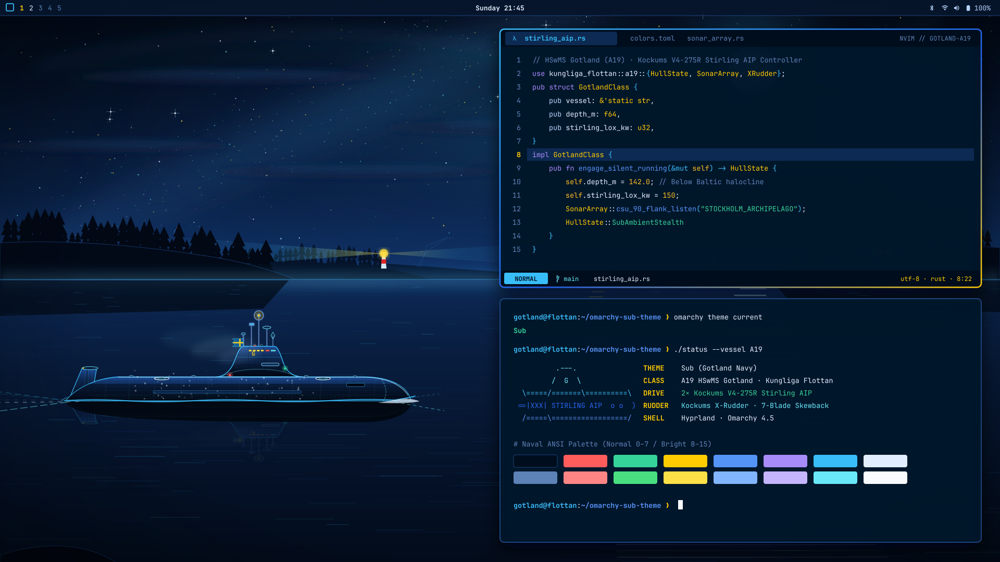
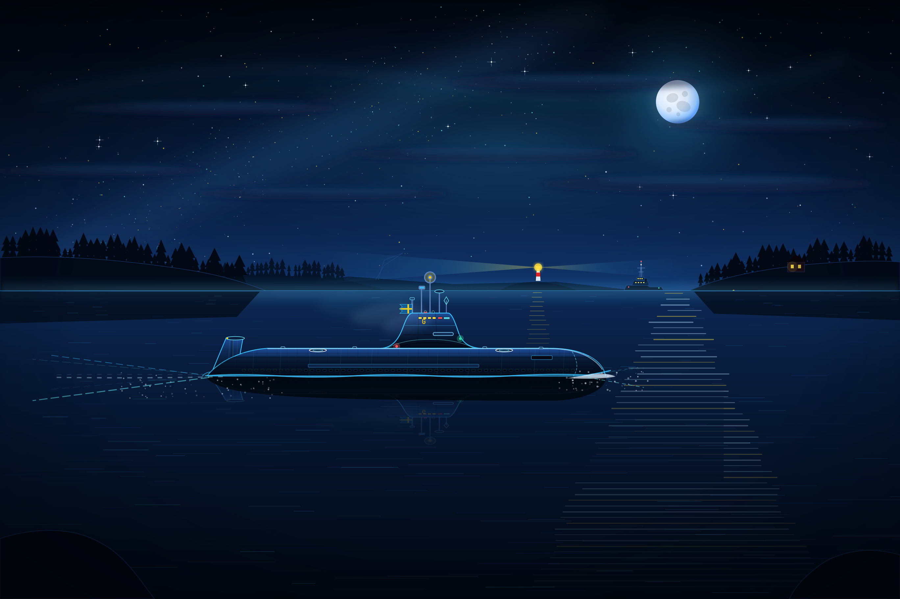
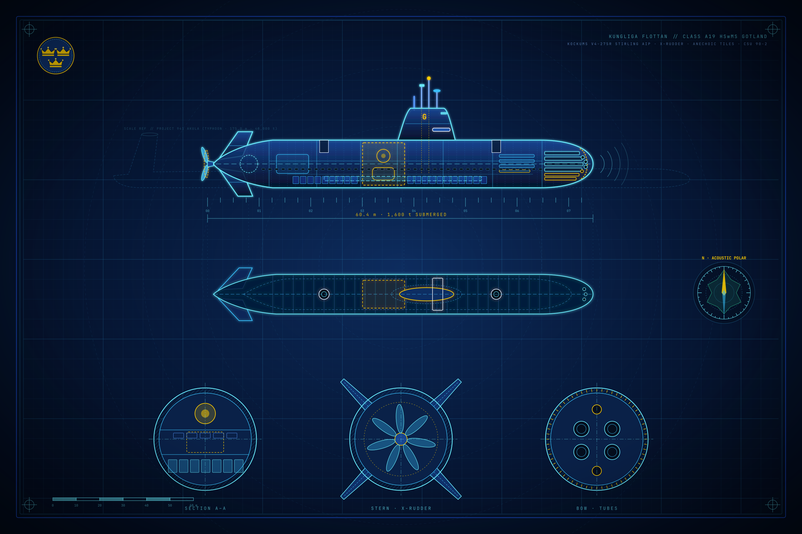
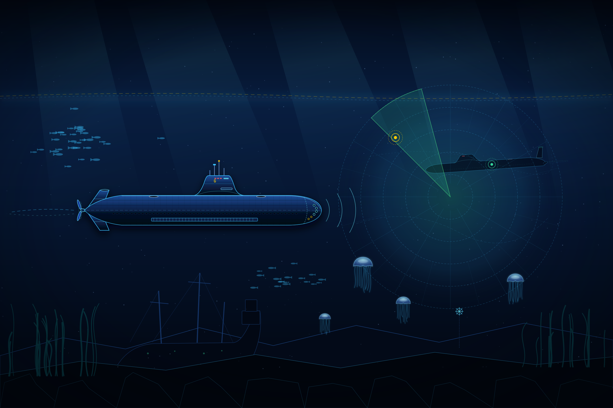
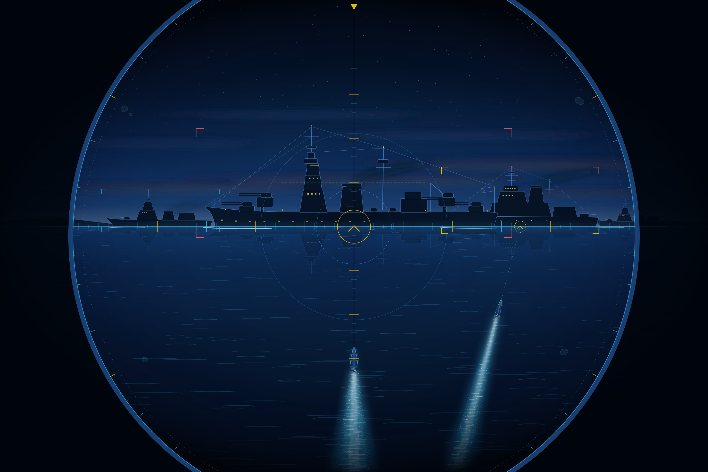

# Windows Sub Theme (`windows-sub-theme`) ⚓🇸🇪🪟

**Swedish Navy (*Kungliga Flottan*) · HSwMS Gotland (A19) · Cold War Bluedark, Sonar Cyan & Swedish Gold — for Windows 11.**

A native, zero-patch **Windows 11** & **Windows Terminal** port of [`sgt-nylle/omarchy-sub-theme`](https://github.com/sgt-nylle/omarchy-sub-theme), inspired by [SubWrite](https://subwrite.se), [TechTools](https://techtools.subwrite.se), Sweden's **Gotland-class (A19) Stirling AIP submarine (`HSwMS Gotland`)**, and classic Cold War submarine cinema (*The Hunt for Red October*).

> [!NOTE]
> **No system file patching (`uxtheme`) or third-party background daemons required.**
> Everything uses official, user-scoped Windows 11 Personalize/DWM registry keys, native `.theme` definitions, the Win32 `user32.dll` wallpaper API, and standard Windows Terminal JSON configuration.

<p align="center">
  
</p>

---

## Repository Structure

```text
windows-sub-theme/
├── backgrounds/
│   ├── 01-stockholm-archipelago-night-patrol.png   # Default: Surfaced Cold War bluedark night patrol
│   ├── 02-hms-gotland-tactical-blueprint.png       # Naval intelligence & engineering blueprint
│   ├── 03-baltic-sonar-silent-running.png          # Silent running below the Baltic halocline
│   └── 04-dawn-torpedo-run.png                     # Attack periscope convoy torpedo salvo
├── apply-theme.ps1                                 # Non-admin PowerShell installer & rollback script
├── sub-theme.theme                                 # Native Windows 11 double-clickable .theme file
├── windows-terminal-scheme.json                    # Standalone Windows Terminal scheme snippet
├── preview.png                                     # Palette & desktop showcase
├── LICENSE                                         # MIT License
└── README.md
```

---

## Quick Start

Clone or download this repository anywhere on your Windows 11 machine:

```powershell
git clone https://github.com/sgt-nylle/windows-sub-theme.git
cd windows-sub-theme
```

### Option A: PowerShell One-Liner (Recommended)
Applies Dark Mode, exact DWM active/inactive window border & taskbar colors, sets the wallpaper live without signing out, and automatically injects the `"Sub Theme"` color scheme into **Windows Terminal** (`settings.json`):

```powershell
powershell -ExecutionPolicy Bypass -Scope Process -File .\apply-theme.ps1 -SetAsDefaultTerminalScheme
```

Switch between any of the **4 included `2736×1824` Cold War bluedark wallpapers** at any time:

```powershell
# 1 = Stockholm Archipelago Night Departure (Default)
# 2 = HSwMS Gotland Naval Intelligence Blueprint
# 3 = Baltic Thermocline — Silent Running (Hunt for Red October Vibe)
# 4 = Periscope Convoy Torpedo Salvo (Cold War Bluedark Twilight)
powershell -ExecutionPolicy Bypass -Scope Process -File .\apply-theme.ps1 -WallpaperIndex 3
```

### Option B: Native `.theme` File (Double-Click)
Double-click **`sub-theme.theme`** in File Explorer. Windows 11 will open **Settings → Personalization → Themes**, switch both `SystemMode` and `AppMode` to `Dark`, apply the Gotland Navy `ColorizationColor` (`#164682`), and configure the 4-wallpaper desktop slideshow.

---

## Four Included Cold War Bluedark Wallpapers (`2736×1824`)

<table>
  <tr>
    <td width="50%" align="center">
      <a href="backgrounds/01-stockholm-archipelago-night-patrol.png">
        
      </a>
      <br><b>01 · Stockholm Archipelago Night Departure (Default)</b>
      <br><i>HSwMS Gotland</i> sailing out on the surface at night in deep Cold War bluedark steel &amp; anechoic tile detail — with free-flooding limber slots, sculpted turtleback sail fairings, white escape-trunk deck rings, cold exhaust mist, a naval escort tug with lattice radar mast, and a silver-blue cratered moon.
    </td>
    <td width="50%" align="center">
      <a href="backgrounds/02-hms-gotland-tactical-blueprint.png">
        
      </a>
      <br><b>02 · HSwMS Gotland (A19) Naval Intelligence Blueprint</b>
      <br>Deep bluedark naval engineering &amp; intelligence plate with internal torpedo reload skids, battery &amp; Stirling AIP compartments, escape trunks, acoustic polar signature rose, a ghosted Cold War Project 941 Typhoon (<i>Red October</i>, 175 m) scale comparison profile, and three cross-sections.
    </td>
  </tr>
  <tr>
    <td width="50%" align="center">
      <a href="backgrounds/03-baltic-sonar-silent-running.png">
        
      </a>
      <br><b>03 · Baltic Thermocline — Silent Running (<i>Hunt for Red October</i> Vibe)</b>
      <br>Deep abyssal bluedark cat-and-mouse scene below the halocline: <i>HSwMS Gotland</i> in full anechoic-tiled stealth trim with red-rigged conn windows and CSU 90-2 flank hydrophone staves pinging a massive Project 941 Typhoon-class submarine lurking in the distant sonar shadow.
    </td>
    <td width="50%" align="center">
      <a href="backgrounds/04-dawn-torpedo-run.png">
        
      </a>
      <br><b>04 · Periscope Convoy Torpedo Salvo (Cold War Bluedark Twilight)</b>
      <br>Attack periscope view in moody Cold War bluedark twilight with optical lens condensation droplets and stadia rangefinding crosshairs locked onto a 4-ship naval surface group as a two-torpedo <i>Torped 62</i> salvo streaks submerged beneath the dark-blue swell.
    </td>
  </tr>
</table>

---

## Color Palette (Extracted from `omarchy-sub-theme/colors.toml`)

| Role | Windows / Terminal Token | Hex | RGB | Description |
| :--- | :--- | :--- | :--- | :--- |
| **Background** | `background` / Inactive Title | `#07162C` | `7, 22, 44` | Deep Baltic Navy CIC Surface |
| **Dark Background** | `black` | `#040E1D` | `4, 14, 29` | Abyssal Navy Trench |
| **Darker Background** | Window Shadow | `#020812` | `2, 8, 18` | Keel Black-Navy Scrim |
| **Elevated Surface** | `StartColorMenu` | `#0F2B52` | `15, 43, 82` | Elevated Navy Card / Taskbar Tint |
| **Selection / Active DWM** | `selectionBackground` / `AccentColor` | `#164682` | `22, 70, 130` | Tactical Navy Selection & Active Frame |
| **Frame Hairline** | `ActiveBorder` | `#1B457D` | `27, 69, 125` | C64 Navy Frame Hairline |
| **Primary Accent** | `cyan` / `HotTrackingColor` | `#38BDF8` | `56, 189, 248` | Periscope & Sonar Telemetry Cyan |
| **Bright Cyan** | `brightCyan` | `#67E8F9` | `103, 232, 249` | Active Hydrophone Pulse Cyan |
| **Foreground** | `foreground` / `white` | `#E2EEFF` | `226, 238, 255` | Crisp Naval Readout White-Blue |
| **Bright Foreground** | `cursorColor` / `brightWhite` | `#F8FBFF` | `248, 251, 255` | Periscope Glint Peak White (Cursor) |
| **Muted / Gray Text** | `brightBlack` | `#5B82B8` | `91, 130, 184` | Steel-Navy Comments & Labels |
| **Yellow / Gold** | `yellow` / `brightYellow` | `#FECC02` / `#FDE047` | `254, 204, 2` | Swedish Naval Ensign Gold (*Örlogsflagga*) |
| **Blue** | `blue` / `brightBlue` | `#5494F7` / `#82B5FF` | `84, 148, 247` | Royal Swedish Navy Blue |
| **Green** | `green` / `brightGreen` | `#34D399` / `#4ADE80` | `52, 211, 153` | Passive Sonar Contact Green |
| **Red** | `red` / `brightRed` | `#FF5C5C` / `#FF8585` | `255, 92, 92` | SubWrite Torpedo / Red Alert |
| **Purple / Magenta** | `purple` / `brightPurple` | `#A78BFA` / `#C4B5FD` | `167, 139, 250` | ESM / Acoustic Intercept Violet |

---

## What `apply-theme.ps1` Modifies (All User-Scoped `HKCU`)

No administrator privileges are needed. The script only touches current-user settings:

1. **`HKCU:\Software\Microsoft\Windows\CurrentVersion\Themes\Personalize`**
   - `AppsUseLightTheme = 0` (Dark Mode for apps)
   - `SystemUsesLightTheme = 0` (Dark Mode for Windows shell/taskbar)
   - `EnableTransparency = 1` (Mica/Acrylic transparency enabled)
   - `ColorPrevalence = 1` (Tints taskbar and Start menu with the navy accent)
2. **`HKCU:\Software\Microsoft\Windows\DWM`**
   - `AutoColorization = 0`
   - `ColorPrevalence = 1` (Tints active window title bars and borders)
   - `ColorizationColor = 0xC4164682` (ARGB `#164682` Tactical Navy Selection)
   - `AccentColor = 0xFF824616` (ABGR `#164682` Active Window Border/Title)
   - `AccentColorInactive = 0xFF2C1607` (ABGR `#07162C` Deep Baltic Navy Inactive Title)
3. **`HKCU:\Software\Microsoft\Windows\CurrentVersion\Explorer\Accent`**
   - `AccentPalette` (8-slot RGBA ramp from `#A5F3FC` / `#38BDF8` Periscope Cyan down to `#164682` and `#040E1D`)
   - `AccentColorMenu = 0xFF824616`, `StartColorMenu = 0xFF522B0F`
4. **Desktop Wallpaper (`HKCU:\Control Panel\Desktop` + `user32.dll`)**
   - Calls `SystemParametersInfo(SPI_SETDESKWALLPAPER, 0, path, SPIF_UPDATEINIFILE | SPIF_SENDWININICHANGE)` so the wallpaper updates immediately without logging out.
5. **Windows Terminal (`settings.json`)**
   - Automatically backs up `settings.json` to `settings.json.subtheme.bak` before appending `"Sub Theme"` to the `schemes` array.

---

## Rollback / Uninstallation

To revert back to standard Windows 11 dark defaults (disabling titlebar/taskbar color prevalence and restoring the default Windows 11 dark wallpaper):

```powershell
powershell -ExecutionPolicy Bypass -Scope Process -File .\apply-theme.ps1 -Revert
```

Or manually via Windows 11 GUI:
1. Open **Settings (`Win + I`) → Personalization → Themes** and click the default **Windows (dark)** theme.
2. In **Windows Terminal**, open **Settings (`Ctrl + ,`) → Color schemes** and select your previous scheme (or restore `settings.json.subtheme.bak`).

---

## Attribution & Related Projects

- **Matrix Community Room (`#subwrite:subwrite.se`):** [https://chat.subwrite.se/#/room/#subwrite:subwrite.se](https://chat.subwrite.se/#/room/#subwrite:subwrite.se) (or via [matrix.to](https://matrix.to/#/#subwrite:subwrite.se))
- **Original Linux / Omarchy Theme:** [`sgt-nylle/omarchy-sub-theme`](https://github.com/sgt-nylle/omarchy-sub-theme)
- **macOS Port:** [`sgt-nylle/macos-sub-theme`](https://github.com/sgt-nylle/macos-sub-theme)
- **SubWrite (Submarine Typing Game):** [https://subwrite.se](https://subwrite.se) ([`sgt-nylle/subwrite`](https://github.com/sgt-nylle/subwrite))
- **TechTools:** [https://techtools.subwrite.se](https://techtools.subwrite.se) ([`sgt-nylle/techtools`](https://github.com/sgt-nylle/techtools))
- **License:** [MIT License](LICENSE) — Created by [sgt-nylle](https://github.com/sgt-nylle).
